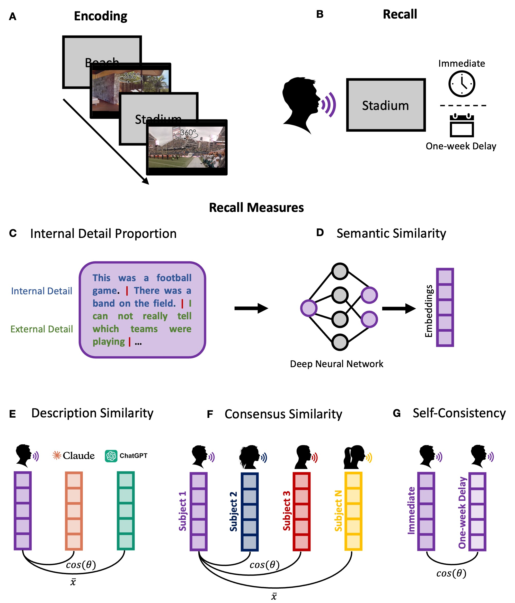
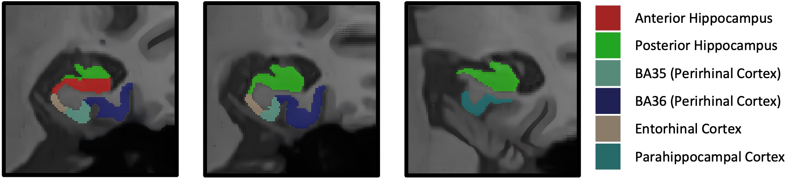

# Medial temporal lobe contributions to scene memory across a one-week delay
[Angelique I. Delarazan](https://aidelarazan.github.io/), Alexis N. Garcia, and Matthew D. Grilli

## Project Description
[PsyArXiv Preprint](https://osf.io/preprints/psyarxiv/5bv37_v1)

[Open Science Framework](https://osf.io/w74jq/overview)

[OpenNeuro](https://openneuro.org/)

Memory for complex experiences is often organized around the events that unfold over time. Yet remembering an experience also requires recovering the environment in which it occurred. Scenes bring together objects, perceptual features, and spatial context within a coherent representation, making scene memory particularly relevant to the medial temporal lobe (MTL). However, comparatively little is known about how these representations change over time or how different features of scene memory relate to MTL structure. Here, fifty-seven cognitively healthy older adults viewed eight 40-second panoramic videos of real-world environments and freely recalled each scene shortly after viewing and one-week later. We characterized recall using the proportion of verifiable details produced (Proportion of Internal Details), the correspondence of each description to the original scene (Description Similarity), its similarity to descriptions produced by other participants (Consensus Similarity), and its consistency across sessions (Self-Consistency). Internal Detail Proportion did not significantly change across the one-week delay, whereas Description Similarity and Consensus Similarity decreased. Participants also produced more verbal output after one week. Relationships with MTL structure similarly differed across measures. The relationship between MTL volume and Internal Detail Proportion changed across the delay, whereas greater MTL volume was associated with higher Description Similarity and Consensus Similarity at delayed recall and with greater Self-Consistency across sessions. MTL volume was unrelated to Word Count. Exploratory regional analyses showed the clearest and most consistent relationships in perirhinal cortex. These relationships were observed while controlling for age. Together, these findings dissociate the amount of information produced from the preservation of scene content over time and suggest that individual differences in MTL structure are particularly relevant to the correspondence and stability of naturalistic scene memories.

### Experimental Design
(A) Encoding: Participants viewed eight 40-second panoramic videos depicting a variety of real-world environments (e.g., a hotel lobby, stadium, distillery, and coastal setting) along with unique titles (Fig. 1A). Each video was created from a static 360° panoramic image obtained from Google Street View and other publicly posted advertisements. Each clip was standardized such that the viewpoint panned continuously around the panoramic scene, allowing participants to see different portions of the environment while the people, objects, and other elements within the scene remained static.

(B) Recall (Immediate and One-week Delay): Participants were cued with the title of each scene, presented in random order, and instructed to picture the scene in their mind and tell the experimenter everything they remember about the scene (Fig. 1B). Participants were provided a maximum time of four minutes and probed to continue if they stopped recalling before two minutes had elapsed.

(C-D) Recall Measures: To obtain several complementary features of scene memory rather than rely on a single measure of recall performance, we characterized the content of each recall using detail-based scoring (Levine et al., 2002) and semantic similarity measures (Cer et al., 2018).
  * (C) Internal Detail Proportion: The Autobiographical Interview scoring protocol (Levine et al., 2002) was used to characterize the internal and external details produced during recall. For each trial, the transcript was segmented into individual details, then tagged by detail type. Internal Detail Proportion scores were calculated by dividing the number of Internal Details by the total number of details produced. Higher Internal Detail proportion scores reflected a greater proportion of the participant’s recall consisting of Internal Details.
  * (E) Description Similarity: To quantify how closely participants’ recall corresponded to the original scene, we compared each recalled descriptions with reference descriptions generated by AI Models. Similarity was calculated separately for each reference description and then averaged across AI Models. Higher Description Similarity reflected greater semantic correspondence between a participant’s recall and the AI-generated reference descriptions of the original scenes.
  * (F) Consensus Similarity: To characterize how closely an individual’s recall resembled that of other participants, we calculated the pairwise similarity between each participant’s recall description and the descriptions produced by the remaining participants for that same scene and session. Pairwise similarity values were then averaged to obtain a Consensus Similarity score, where higher values indicated recall that was more similar to that of the larger group.
  * (G) Self-Consistency. Finally, we examined how consistently participants recalled the same scene across the one-week delay by calculating the similarity between their Session 1 and Session 2 descriptions of the same scene. Higher values indicated greater consistency in recall across sessions.

MRI: A T1-weighted 3D MPRAGE anatomical image was acquired in the sagittal plane (TR = 2300 ms, TE = 2.95 ms, TI = 900 ms, flip angle = 9°, matrix = 256 × 240, 176 slices, voxel size = 1.0 × 1.055 × 1.055 mm, slice thickness = 1 mm, pixel bandwidth = 240 Hz/pixel, phase FOV = 93.75%).

Volumes were obtained using Automatic Segmentation of Hippocampal Subfields (ASHS; Yushkevich et al., 2015), a multi-atlas segmentation approach that registers manually labeled atlas images to each participant’s anatomical image and combines the transformed labels via joint label fusion to derive participant-specific segmentations. We used the ASHS-PMC-T1 atlas (Xie et al., 2019), developed for 3T T1-weighted imaging. Volumes were taken from the “corr_usegray” output in native T1-weighted space.

  

  * MTL Composite: To derive a composite measure of medial temporal lobe (MTL) volume, volumes for the hippocampus, entorhinal cortex, perirhinal cortex, and parahippocampal cortex were summed across hemispheres and standardized across participants. Following similar approaches used in prior work (Bailey et al., 2013; Pettigrew et al., 2017), each regional volume was standardized across participants and separately adjusted for intracranial volume (ICV) by regressing the standardized volume on ICV and retaining the residual. The ICV-adjusted volumes were averaged across the four regions to produce a single MTL composite, with higher values reflecting relatively greater MTL volume after accounting for ICV.
    
## Folder Structure
 * [README.md](./README.md)
 * [data](./data/)
 * [docs](./docs/)
 * [scripts](./scripts/)
    * [analyses](./scripts/analyses/)

## Contact
Angelique I. Delarazan | aidelarazan@arizona.edu | https://aidelarazan.github.io/
